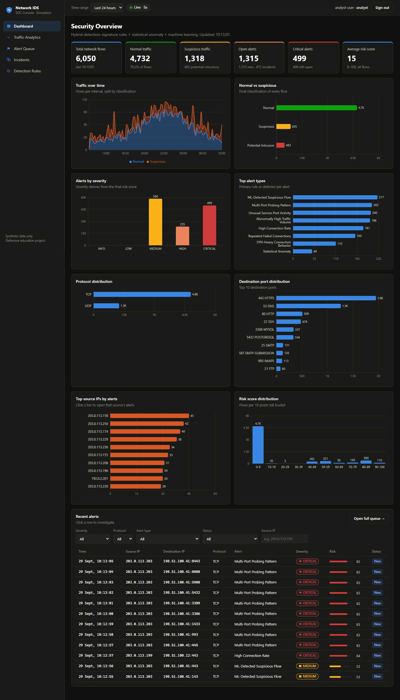
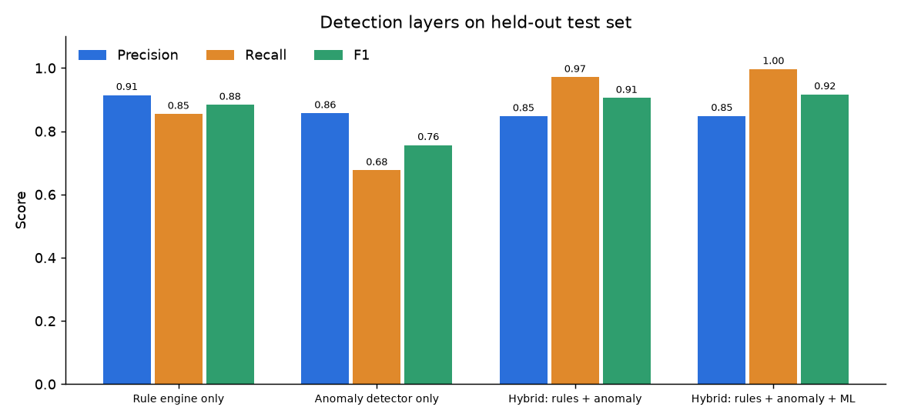
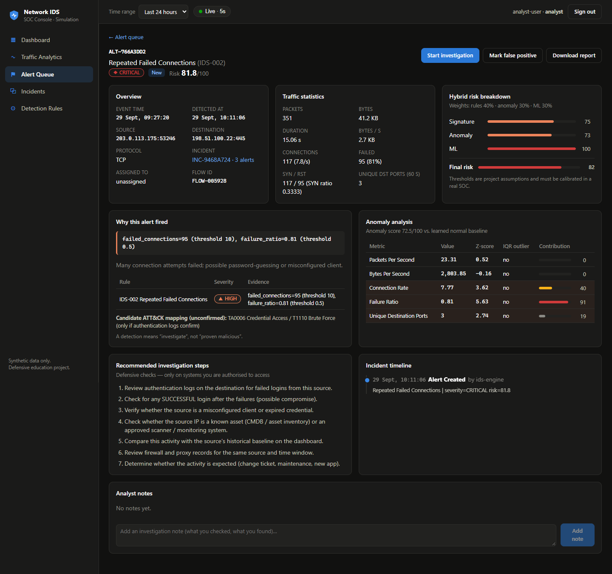
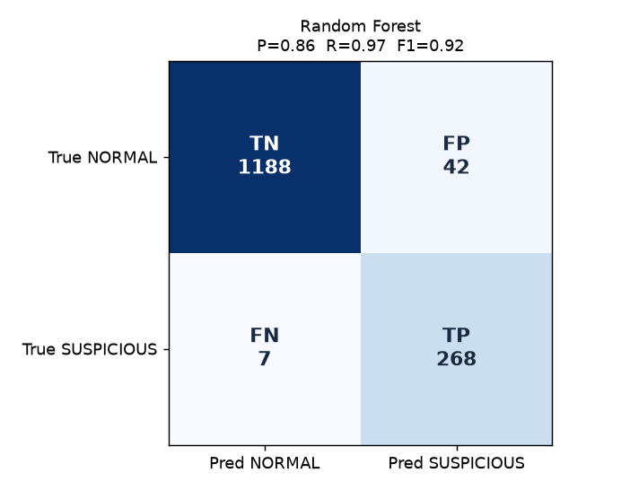

# Network Intrusion Detection System (IDS) Simulation

> **Defensive network intrusion detection simulation featuring synthetic traffic generation, signature-based and anomaly-based detection, risk scoring, alert correlation, SOC analytics, and optional machine learning.**


> **This project is designed exclusively for defensive cybersecurity education. All suspicious network behavior is represented using synthetic data or authorized isolated lab environments.**



---

## Table of Contents
[Overview](#overview) · [Problem Statement](#problem-statement) · [Objectives](#objectives) · [Cybersecurity Relevance](#cybersecurity-relevance) · [IDS Concepts](#ids-concepts) · [Architecture](#architecture) · [Technology Stack](#technology-stack) · [Synthetic Dataset](#synthetic-dataset) · [Traffic Simulator](#traffic-simulator) · [Feature Engineering](#feature-engineering) · [Signature-Based Detection](#signature-based-detection) · [Anomaly Detection](#anomaly-detection) · [Machine Learning](#machine-learning) · [Hybrid Detection](#hybrid-detection) · [Risk Scoring](#risk-scoring) · [Alert Generation](#alert-generation) · [Alert Correlation](#alert-correlation) · [SOC Dashboard](#soc-dashboard) · [Incident Investigation](#incident-investigation) · [API Documentation](#api-documentation) · [Installation](#installation) · [Usage](#usage) · [Testing](#testing) · [Security](#security) · [Results](#results) · [False Positives & False Negatives](#false-positives--false-negatives) · [Limitations](#limitations) · [Future Improvements](#future-improvements) · [Screenshots](#screenshots) · [Learning Outcomes](#learning-outcomes) · [Ethical Disclaimer](#ethical-disclaimer) · [Author](#author)

---

## Overview

A complete, runnable **Network-based Hybrid Intrusion Detection System** simulation. It:

1. **Generates** 6,000+ labelled synthetic network-flow records (normal traffic + 6 suspicious patterns) using documentation-only IP ranges.
2. **Streams** live synthetic flows into a REST API (the simulator never sends real packets).
3. **Extracts** 15 security features per flow, including per-source sliding-window features.
4. **Detects** with three layers: 6 signature rules, a statistical anomaly detector (Z-score + IQR), and an optional Random Forest.
5. **Scores** each flow with a configurable weighted hybrid risk score (0–100).
6. **Alerts** with severity, reason, candidate MITRE ATT&CK mapping and a defensive investigation playbook.
7. **Correlates** related alerts into incidents to fight alert fatigue.
8. **Visualises** everything in a React SOC console with a live dashboard, traffic analytics, alert queue, investigation page, incident view and rule tuning.
9. **Supports the analyst workflow**: NEW → INVESTIGATING → RESOLVED / FALSE_POSITIVE, notes, audit timeline and downloadable incident reports.

Every metric in this README was **computed by the code in this repository**. Nothing is hand-written.

## Problem Statement

Organisations generate huge volumes of network traffic, and attackers hide inside it. Signature rules alone miss new behaviour, anomaly detectors alone drown analysts in false positives, and raw alerts without context or grouping overwhelm a Security Operations Centre (SOC). Students also rarely get safe, legal access to realistic intrusion data.

**This project answers:** *How can we build, measure and operate an explainable hybrid IDS end to end, from raw flow records to an analyst's resolved incident, using only safe synthetic data?*

## Objectives

- Build a safe synthetic-traffic generator and a real-time flow simulator.
- Engineer security-relevant flow features, handling malformed input safely.
- Implement signature, statistical-anomaly and ML detection, then combine them into a hybrid risk score.
- Generate, prioritise and correlate alerts like a real SOC tool.
- Deliver a professional SOC dashboard with an investigation and incident-management workflow.
- **Measure** detection quality honestly (precision, recall, F1, confusion matrices) and document false positives and negatives.
- Apply secure-coding practices: validation, RBAC, rate limiting, audit logging, no secrets in code.

## Cybersecurity Relevance

| Skill area | Where it appears in this project |
|---|---|
| Network security & traffic analysis | flow model, protocols/ports, features such as SYN ratio and failure ratio |
| Intrusion detection | `ids/` hybrid engine: rules, anomaly detection, ML |
| Security monitoring / SOC | live dashboard, alert queue, triage workflow, incidents |
| Detection engineering | detection-as-code rules, tunable thresholds, measured precision and recall |
| Incident response | investigation page, playbooks, notes, timeline, incident report |
| Security analytics & ML | baselines, Z-score/IQR, Random Forest, Isolation Forest, confusion matrices |
| Secure coding | input validation, parameterised SQL, RBAC, rate limiting, audit trail, security headers |

Full explanations of IDS usage in SOCs, banks, cloud providers, enterprises, data centres, government, universities, e-commerce and MSSPs, and of the related job roles, are in **[docs/01_IDS_CONCEPTS.md](docs/01_IDS_CONCEPTS.md)**.

## IDS Concepts

| Term | One-line meaning |
|---|---|
| **IDS** | Monitors activity and **raises alerts** about suspicious behaviour. |
| **IPS** | Sits inline and can **automatically block**. This project deliberately does not block. |
| **Packet** | One unit of data on the wire (headers plus payload). |
| **Flow** | A summary of packets between two endpoints (IPs, ports, protocol, counts, duration). This project analyses flows. |
| **Event** | A single observation (one flow record). |
| **Alert** | An event (or detection) that needs a human to look at it. |
| **Incident** | A group of related alerts that together require investigation. |
| **NIDS / HIDS** | Network-based (watches traffic) vs host-based (watches one machine's logs and files). |
| **Signature vs anomaly** | "Matches a known bad pattern" vs "differs from learned normal". |

The project simulates a **Network-based Hybrid IDS**: network-based because it analyses flow records, and hybrid because it combines signature, anomaly and ML detection. Beginner and technical explanations of every concept are in [docs/01_IDS_CONCEPTS.md](docs/01_IDS_CONCEPTS.md).

## Architecture

```
 Synthetic Traffic Generator / Real-time Simulator   (DATA ONLY — no packets)
                     │  POST /api/flows (sensor API key, loopback only)
                     ▼
               Flow Collector  ── validation (IPs, ports, protocol, numbers)
                     ▼
             Feature Extractor ── 15 features + 60 s per-source window
          ┌──────────┼───────────┐
          ▼          ▼           ▼
     Rule Engine  Anomaly     ML Model
     (IDS-001..6) Detector    (Random Forest,
                  (Z / IQR)    optional)
          └──────────┼───────────┘
                     ▼
         Risk Engine (weighted 40/30/30 or 60/40 + safety floors)
                     ▼
     Alert Engine ── severity · reason · playbook · ATT&CK hint
                     ▼
     Correlation ── incidents (source + type + 60 s window)
                     ▼
     Security Database (SQLite) ──► SIEM JSONL export
                     ▼
     REST API (FastAPI, RBAC, rate limiting) ──► SOC Dashboard (React, polling)
                     ▼
                  Analyst ── triage · investigate · document · resolve
```

Component-by-component explanation and the full folder guide: **[docs/02_ARCHITECTURE.md](docs/02_ARCHITECTURE.md)**.

## Technology Stack

| Layer | Technology | Why |
|---|---|---|
| Detection engine | Python 3.11+, NumPy | readable, testable, industry standard for security tooling |
| ML | scikit-learn, pandas, joblib, matplotlib | LR / RF / Isolation Forest, metrics, figures |
| API | FastAPI + Pydantic + Uvicorn | typed validation and auto-generated docs at `/docs` |
| Database | SQLite (stdlib `sqlite3`, WAL mode) | zero setup; parameterised SQL only |
| Frontend | React 18 + Vite + Recharts + React Router | fast dev server, reusable chart components |
| Real-time | HTTP polling (5 s) | simplest reliable option for beginners (see [architecture doc](docs/02_ARCHITECTURE.md#15-real-time-simulation)) |
| Testing | pytest + FastAPI TestClient | 37 automated tests with auto-generated result table |

## Synthetic Dataset

`python -m simulator.generate_dataset` → **`data/network_traffic.csv`** (6,019 rows, seed 42, 24 h span, business-hours traffic curve).

**Columns:** `flow_id, timestamp, source_ip, destination_ip, source_port, destination_port, protocol, packet_count, byte_count, duration_seconds, connection_count, failed_connection_count, syn_count, rst_count, average_packet_size, label, scenario_type`

| Scenario | Label | Rows | What it represents |
|---|---|---:|---|
| NORMAL_WEB | NORMAL | 2,189 | HTTPS/HTTP browsing (incl. refused connections and busy pages) |
| NORMAL_DNS | NORMAL | 1,259 | UDP/53 lookups |
| NORMAL_DATABASE | NORMAL | 668 | app servers → PostgreSQL/MySQL |
| NORMAL_EMAIL | NORMAL | 367 | SMTP / submission / IMAPS |
| NORMAL_SSH | NORMAL | 339 | admin sessions (with the occasional mistyped password) |
| NORMAL_BULK_TRANSFER | NORMAL | 98 | nightly backups: huge but legitimate |
| MULTI_PORT_PROBING_PATTERN | SUSPICIOUS | 306 | bursts: one source → many ports |
| UNUSUAL_PORT_ACTIVITY | SUSPICIOUS | 191 | watch-listed ports (4444, 6667, 23, exposed 3389 …) |
| REPEATED_FAILED_CONNECTIONS | SUSPICIOUS | 190 | password-guessing-like failures (20% "low and slow") |
| HIGH_CONNECTION_RATE | SUSPICIOUS | 187 | abnormal connection frequency |
| HIGH_TRAFFIC_VOLUME | SUSPICIOUS | 115 | abnormally large outbound transfers |
| SYN_HEAVY_PATTERN | SUSPICIOUS | 110 | half-open, SYN-dominated behaviour |

**Safety:** only RFC 5737 documentation ranges are used (`192.0.2.0/24` internal clients, `198.51.100.0/24` servers, `203.0.113.0/24` external hosts). These are never routed on the Internet. Normal traffic deliberately includes look-alikes (backups, busy pages, failed logins), so detection is realistically imperfect.

## Traffic Simulator

`simulator/traffic_simulator.py` continuously generates flow **events** (JSON), prints them, or POSTs them to your **local** backend.

```bash
python -m simulator.traffic_simulator --mode normal --speed slow
python -m simulator.traffic_simulator --mode mixed --speed fast --post http://127.0.0.1:8000/api/flows
python -m simulator.traffic_simulator --scenario multi_port --post http://127.0.0.1:8000/api/flows
```

`--mode normal|mixed`, `--speed slow|medium|fast` (or `--interval`), `--count`, `--scenario https|dns|ssh|failed|high_rate|multi_port|syn|unusual_port|volume|backup`, `--json`, `--seed`. **Safety guard:** `--post` refuses any non-loopback URL.

## Feature Engineering

`extract_network_features()` in [ids/feature_extractor.py](ids/feature_extractor.py) produces:

| Feature | Formula | Why it matters |
|---|---|---|
| packet_count, byte_count, duration | from flow | raw volume and length |
| bytes_per_second | bytes / max(duration, 1 s) | floods, exfiltration-like surges |
| packets_per_second | packets / max(duration, 1 s) | packet floods |
| average_packet_size | bytes / packets | tiny packets are typical of probes and SYN floods |
| connection_count, failed_connection_count | from flow | automation, guessing |
| failure_ratio | failed / connections | password guessing, probing closed ports |
| syn_count, rst_count, syn_ratio | SYN / packets | half-open (SYN-heavy) behaviour |
| unique_destination_ports / _ips | distinct values per source in a **60 s sliding window** | probing only shows in aggregate |
| connection_rate | connections / max(duration, 1 s) | abnormal connection frequency |

Robustness: division by zero is guarded (`safe_divide`, 1 s rate floor); missing numbers are imputed as 0 **with a recorded data-quality warning**; malformed IPs, invalid ports and unsupported protocols are **rejected**.

## Signature-Based Detection

`analyze_flow()` in [ids/rule_engine.py](ids/rule_engine.py). Thresholds are configurable (in `ids/config.py`, and live via `PUT /api/rules/{id}`).

| Rule | Name | Default trigger | Severity |
|---|---|---|---|
| IDS-001 | High Connection Rate | ≥ 10 conn/s **or** ≥ 150 connections | HIGH |
| IDS-002 | Repeated Failed Connections | ≥ 10 failures **and** failure ratio ≥ 0.5 | HIGH |
| IDS-003 | Multi-Port Probing Pattern | ≥ 12 distinct destination ports from one source in 60 s | HIGH |
| IDS-004 | SYN-Heavy Connection Behavior | ≥ 100 SYN **and** SYN ratio ≥ 0.7 (TCP) | CRITICAL |
| IDS-005 | Unusual Service-Port Activity | destination port on the watch-list | MEDIUM |
| IDS-006 | Abnormally High Traffic Volume | ≥ 500 MB **or** ≥ 5 MB/s | MEDIUM |

> A rule match indicates **suspicious behaviour requiring investigation**. It does **not** automatically prove malicious activity.

## Anomaly Detection

`AnomalyDetector.calculate_anomaly_score()` in [ids/anomaly_detector.py](ids/anomaly_detector.py):

```
Normal Baseline → Observe New Flow → Compare Against Baseline → Calculate Deviation → Anomaly Score (0–100)
```

- The baseline (mean, std, Q1, Q3) is learned from **normal training flows only** for packet rate, byte rate, connection rate, failure ratio and destination-port diversity. It is saved to `models/baseline.json`.
- Heavy-tailed metrics are `log1p`-transformed. Each metric's **Z-score** maps linearly from z = 2 (score 0) to z = 6 (score 100). **IQR** outer-fence outliers add confirmation points.
- Score = 0.7 × worst metric + 0.3 × mean metric + IQR bonus. The top contributors are shown to the analyst.
- The **moving average** appears twice: an optional EWMA adaptive baseline (off by default because of poisoning risk) and trend smoothing on the traffic chart.

It can flag **never-seen** behaviour, but "unusual" is not "malicious", so it produces more false positives than rules.

## Machine Learning

Optional layer trained by `python -m ml.train_model` on the 10 specified features, with a stratified 75/25 split (seed 42).

- **Supervised** (learn from labels): Logistic Regression, Random Forest.
- **Unsupervised** (learn "normal" only, no labels): Isolation Forest.

The Random Forest probability feeds the hybrid score. Results are in [Results](#results). **Accuracy alone is insufficient:** 81.7% of flows are normal, so a model that always says NORMAL scores 81.7% accuracy while catching nothing.

## Hybrid Detection

```
Final risk = 0.40 × Signature + 0.30 × Anomaly + 0.30 × ML          (ML enabled)
Final risk = 0.60 × Signature + 0.40 × Anomaly                      (ML disabled)
```

Weights are configurable. Two **safety floors**, both discovered by measuring the system, stop strong evidence from being averaged away:

1. **Rule floor.** A MEDIUM rule match floors the risk at 41, and HIGH or CRITICAL at 61. With the first, weaker floor (one band lower), the hybrid detector *lost* recall versus rules alone (0.676 vs 0.855), because MEDIUM-rule matches were averaged down to NORMAL.
2. **Single-detector floor.** Anomaly ≥ 75 or ML ≥ 85% floors the risk at 41. Without it, anomaly-only detections could never exceed 40 points, so the anomaly layer added nothing.

## Risk Scoring

| Score | Band | Alert severity | Classification |
|---|---|---|---|
| 0–20 | NORMAL | INFO | NORMAL |
| 21–40 | LOW RISK | LOW | NORMAL |
| 41–60 | SUSPICIOUS | MEDIUM | SUSPICIOUS |
| 61–80 | HIGH RISK | HIGH | SUSPICIOUS |
| 81–100 | CRITICAL INVESTIGATION | CRITICAL | POTENTIAL_INTRUSION |

> These thresholds are **project assumptions**. A real SOC calibrates them against its own traffic, alert volume and analyst capacity.

## Alert Generation

An alert is raised when any rule matches or the risk is ≥ 41. `generate_alert()` returns `alert_id, timestamp, source/destination IP and port, protocol, rule_id, alert_type, severity, risk_score, description, reason, matched_rules, mitre_hint, recommended_steps, status=NEW`.

```
ALERT ID:    ALT-AF495ADC
TYPE:        High Connection Rate (IDS-001)   + also matched IDS-002
SEVERITY:    CRITICAL
SOURCE:      203.0.113.149:51515
DESTINATION: 198.51.100.22:22 (TCP)
RISK:        87.9/100   (signature 80 / anomaly 86.4 / ML 100)
REASON:      connection_rate=20.0/s (threshold 10.0/s), connection_count=400 (threshold 150)
```

## Alert Correlation

`correlate_alerts()` in [ids/correlation.py](ids/correlation.py) groups alerts by **source IP + alert type + a sliding 60 s window**. In the tests, 100 alerts from one source within 50 s become **one incident** (plus one late alert and one from another source: 102 alerts → 3 incidents, a 97% reduction). The backend applies the same logic live, so the dashboard's Incidents page shows the groups.

**Event** = an individual observation · **Alert** = a detection requiring attention · **Incident** = a collection of related alerts requiring investigation.

## SOC Dashboard

React console (`frontend/`), dark SOC theme, auto-refresh by **polling every 5 s** (with a pause toggle):

- **KPI cards:** total flows, normal, suspicious, open alerts, critical alerts, average risk.
- **8 dashboard charts:** traffic over time, normal vs suspicious, alerts by severity, top alert types, protocol distribution, destination-port distribution, top source IPs by alerts, risk-score distribution.
- **Traffic Analytics page:** packets/s, bytes/s, connections/min, failed connections, flows vs moving average, risk timeline, alert timeline, protocol and port distributions. Each chart states what it tells an analyst.
- **Recent-alerts table** with filters for severity, protocol, alert type, status, source IP and time range.
- Severity is always shown with an icon **and** a text label, never colour alone.

## Incident Investigation

Clicking an alert opens the investigation page. It shows:

- **Context:** alert ID, time, source and destination, protocol and ports, traffic statistics.
- **Detection evidence:** matched rules with evidence, a per-metric Z-score table, the ML score and a risk breakdown.
- **Guidance:** the reason, a candidate ATT&CK mapping (clearly marked as unconfirmed) and **recommended defensive investigation steps**.
- **Record keeping:** the incident link, an audit **timeline**, **analyst notes** and a **Markdown incident report** download.

Status workflow: `NEW → INVESTIGATING → RESOLVED | FALSE_POSITIVE` (re-open allowed). Illegal jumps return 409, and **closing requires a resolution note**.

## API Documentation

Interactive docs are at `http://127.0.0.1:8000/docs`. Full reference (request, response, validation, status codes, authN/authZ, errors): **[docs/03_API.md](docs/03_API.md)**.

| Method | Endpoint | Role |
|---|---|---|
| POST | `/api/flows` | sensor, admin |
| GET | `/api/flows`, `/api/flows/{id}` | analyst, admin |
| GET | `/api/alerts`, `/api/alerts/{id}` | analyst, admin |
| PUT | `/api/alerts/{id}/status` | analyst, admin |
| POST | `/api/alerts/{id}/notes` | analyst, admin |
| GET | `/api/alerts/{id}/report`, `/api/alerts/{id}/siem` | analyst, admin |
| GET | `/api/incidents`, `/api/incidents/{id}` | analyst, admin |
| GET | `/api/dashboard/stats`, `/traffic`, `/alerts` | analyst, admin |
| GET / PUT | `/api/rules`, `/api/rules/{id}` | read: analyst · write: **admin** |
| GET | `/api/audit-log` | admin |
| GET | `/api/health` | public |

## Installation

Prerequisites: **Python 3.11+**, **Node.js 18+**, Git.

```bash
git clone https://github.com/SNischayPrasad/Network-Intrusion-Detection-System-Simulation.git
cd Network-Intrusion-Detection-System-Simulation

python -m venv .venv
# Windows:  .venv\Scripts\activate      macOS/Linux:  source .venv/bin/activate
pip install -r requirements.txt
cp .env.example .env            # Windows PowerShell: Copy-Item .env.example .env

cd frontend && npm install && cd ..
```

## Usage

```bash
# 1. Generate the synthetic dataset (6,019 flows)
python -m simulator.generate_dataset

# 2. Train the anomaly baseline + ML models and write evaluation reports
python -m ml.train_model

# 3. Load 24 h of history into the database (about 7 s)
python scripts/seed_database.py --reset

# 4. Start the backend               -> http://127.0.0.1:8000/docs
uvicorn backend.app:app --port 8000

# 5. Start the dashboard (new terminal) -> http://localhost:5173
cd frontend && npm run dev

# 6. Stream live synthetic traffic (new terminal)
python -m simulator.traffic_simulator --mode mixed --speed fast --post http://127.0.0.1:8000/api/flows

# 7. Run the scripted SOC walkthrough (steps 5–12 of the guide)
python scripts/demo_walkthrough.py
```

Sign in with the **analyst** key from `.env` (or the **admin** key to tune rules). The complete step-by-step virtual lab with expected outputs is in **[docs/05_SIMULATION_GUIDE.md](docs/05_SIMULATION_GUIDE.md)**.

## Testing

```bash
python -m pytest -v
```

**37 automated tests, all passing.** They cover normal TCP/UDP/DNS/HTTPS traffic, all six suspicious patterns, invalid IPs, ports and protocols, missing values, zero duration, features, rules, anomaly, risk, alerts, correlation, the status workflow, notes, database storage, dashboard statistics, ML prediction, API validation, an empty dataset, duplicate events, authentication/RBAC, rule hot-reload, reports and security headers. Each run regenerates **[reports/test_results.md](reports/test_results.md)** with *Test ID · Scenario · Input · Expected · Actual · Pass/Fail*. Details: [docs/06_TESTING.md](docs/06_TESTING.md).

## Security

Controls built into the code:

- **Data handling:** synthetic data only, with no packet payload fields at all (unknown fields are rejected).
- **Access control:** API-key authentication compared in constant time, and **RBAC** with least privilege (sensor / analyst / admin).
- **Input safety:** Pydantic plus semantic validation, parameterised SQL everywhere, and length limits and control-character stripping on notes.
- **Traffic protection:** per-client rate limiting (HTTP 429), strict CORS, and security headers (CSP, nosniff, DENY).
- **Error handling:** no stack traces are returned to clients.
- **Accountability:** an append-only **audit log** of alert creation, status changes, notes and rule edits (rule weakening is a classic defence-evasion risk). Closure notes are mandatory.
- **Secrets and models:** secrets live in `.env` (git-ignored). The backend warns when development keys are in use. Model pickles are git-ignored and loaded only from the local `models/` folder.

Why IDS data is itself sensitive, and what production would add (SSO/MFA, TLS, encrypted storage, log integrity): [docs/07_SECURITY_AND_PRIVACY.md](docs/07_SECURITY_AND_PRIVACY.md).

## Results

All numbers were measured on the **held-out test set (1,505 flows; 275 suspicious)** by `python -m ml.train_model`. The full report is in [reports/model_evaluation.md](reports/model_evaluation.md).

**ML models**

| Model | Precision | Recall | F1 | FPR | ROC-AUC |
|---|---|---|---|---|---|
| Logistic Regression | 0.812 | 0.956 | 0.878 | 5.0% | 0.985 |
| **Random Forest** | **0.865** | **0.975** | **0.916** | 3.4% | 0.996 |
| Isolation Forest (unsupervised) | 0.579 | 0.975 | 0.726 | 15.9% | 0.968 |

**Detection layers (why hybrid?)**

| Detector | Precision | Recall | F1 | False-positive rate | Missed (FN) |
|---|---|---|---|---|---|
| Rule engine only | 0.914 | 0.855 | 0.883 | 1.8% | 40 |
| Anomaly detector only | 0.857 | 0.676 | 0.756 | 2.5% | 89 |
| Hybrid: rules + anomaly | 0.848 | 0.971 | 0.905 | 3.9% | 8 |
| **Hybrid: rules + anomaly + ML** | 0.848 | **0.996** | **0.916** | 4.0% | **1** |



**Random Forest confusion matrix:** TP 268 · FP 42 · FN 7 · TN 1,188.

**Scenario A–G results** (actual engine output, [reports/scenario_results.md](reports/scenario_results.md)):

| Scenario | Rule triggered | Risk | Classification |
|---|---|---|---|
| A Normal HTTPS | none | 0.0 | NORMAL |
| B Normal DNS | none | 0.3 | NORMAL |
| C Repeated failed connections | IDS-002 | 82.5 | POTENTIAL_INTRUSION |
| D High connection rate | IDS-001 | 84.4 | POTENTIAL_INTRUSION |
| E Multi-port probing-like (20 ports) | IDS-003 (from record 12) | 83.3 | POTENTIAL_INTRUSION |
| F SYN-heavy | IDS-004 + 001 + 002 | 96.1 | POTENTIAL_INTRUSION |
| G High traffic volume | IDS-006 | 54.4 | SUSPICIOUS |

**Performance:** the engine takes about 0.2 ms per flow without ML. Replaying the 6,019-flow dataset through the full pipeline including the database takes about 7 s (~840 flows/s).

> The data is synthetic, so absolute scores are optimistic compared with real networks. The **relative** behaviour of each layer, and the trade-off between recall and false positives, is the meaningful result.

## False Positives & False Negatives

- **False positive** = legitimate traffic flagged. Measured example: **nightly backups (`NORMAL_BULK_TRANSFER`) were flagged 81.5% of the time**, because a 2 GB transfer looks like exfiltration to volume rules. Busy web pages were flagged 4.1% of the time.
- **False negative** = suspicious traffic missed. Measured example: rules alone missed 40 suspicious test flows, mostly "low and slow" failed logins under the thresholds and the first 11 records of each port-probing burst. The hybrid engine missed 1.
- **Both matter:** false positives cause alert fatigue, and fatigued analysts miss real attacks. False negatives are breaches nobody sees.
- **Improvements:** better baselines per host and time of day, multiple detection methods, threshold tuning, analyst feedback (FALSE_POSITIVE closures), and context such as asset inventory or an allow-list for backup servers.

Deep dive with confusion-matrix explanations: [docs/01_IDS_CONCEPTS.md](docs/01_IDS_CONCEPTS.md#false-positives--false-negatives).

## Limitations

- **Evaluation data:** the data is synthetic and generated by the same code that labels it, so real traffic will be messier and results will be lower.
- **Visibility:** the system works on flow records, with no payload or deep-packet inspection and no TLS metadata.
- **Correlation:** the per-source window and correlation are in-memory per process, and correlation groups by alert *type*. A probing source that first raises ML alerts and later rule alerts appears as two incidents.
- **Authentication:** API-key auth is simplified. There is no SSO, MFA or per-user identity.
- **Scale:** SQLite and polling suit a single-node demo, not millions of flows a second.
- **Model maintenance:** ML models are not retrained automatically, and there is no drift monitoring.

## Future Improvements

All of these are defensive:

- **Data sources:** authorised PCAP ingestion, real-time NetFlow/IPFIX ingestion, and **Zeek** (conn.log) or **Suricata** (EVE JSON) as sensors.
- **Integration and enrichment:** SIEM forwarding via Filebeat or Fluent Bit to Elastic, Wazuh or Splunk, plus threat-intelligence enrichment (reputation lists, ASN, geolocation).
- **Detection quality:** per-host and time-of-day behavioural baselines, better anomaly models (seasonal, autoencoder), cross-type correlation (source-centric incidents), UEBA, and rule tuning driven by FALSE_POSITIVE feedback.
- **Deployment and operations:** cloud VPC flow-log monitoring, Docker/Kubernetes deployment, centralised logging, SSO with MFA, and model drift monitoring with scheduled retraining.

## Screenshots

All screenshots live in [`screenshots/`](screenshots/). The checklist of 27 proof screenshots with professional filenames is in [docs/09_GITHUB_AND_SCREENSHOTS.md](docs/09_GITHUB_AND_SCREENSHOTS.md#screenshot--proof-checklist).

| Dashboard | Investigation | Confusion matrix |
|---|---|---|
|  |  |  |

## Learning Outcomes

- **Detection design:** designing detection as layered, measurable, explainable components.
- **Security engineering:** turning raw flow fields into security features, and why rate floors and windows matter.
- **Measurement:** why precision, recall and FPR beat accuracy, and how false positives drive analyst fatigue.
- **Evidence-based fixes:** fixing design flaws discovered by measurement (the two risk floors).
- **SOC operations:** triage, investigation, documentation, correlation and audit trails.
- **Secure APIs:** validation, RBAC, rate limiting and secret management.
- **Full stack:** Python, FastAPI, SQLite, React and scikit-learn.

## Ethical Disclaimer

This project is designed exclusively for **defensive cybersecurity education**. All suspicious network behaviour is represented using **synthetic data** or authorised isolated lab environments. It contains **no** scanning, exploitation, flooding, credential-theft or evasion functionality. The simulator produces JSON records only, and it refuses to send them anywhere except `localhost`. Only monitor networks you own or are explicitly authorised to monitor.

## Author

**Nischay** — Cybersecurity student
GitHub: [SNischayPrasad](https://github.com/SNischayPrasad) · LinkedIn: `https://www.linkedin.com/in/<your-profile>`

Released under the [MIT License](LICENSE).

---

**Documentation index:** [Concepts](docs/01_IDS_CONCEPTS.md) · [Architecture](docs/02_ARCHITECTURE.md) · [API](docs/03_API.md) · [Database](docs/04_DATABASE.md) · [Simulation guide](docs/05_SIMULATION_GUIDE.md) · [Testing](docs/06_TESTING.md) · [Security](docs/07_SECURITY_AND_PRIVACY.md) · [SOC, ATT&CK & SIEM](docs/08_SOC_MITRE_SIEM.md) · [GitHub & screenshots](docs/09_GITHUB_AND_SCREENSHOTS.md) · [Resume & interview kit](docs/10_CAREER_KIT.md) · [Project report](reports/PROJECT_REPORT.md)
