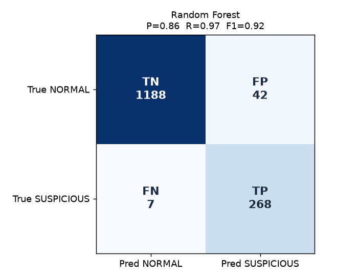

# 01 · IDS Concepts, Industry Relevance & Detection Theory

This guide covers project-brief sections **1, 2, 3, 28, 29, 31 and 32**. Every concept comes in two versions:

- **A. Simple:** explained the way you would explain it to a friend.
- **B. Technical:** explained the way you would say it in an interview.

---

## 1. Project explanation

### What is an IDS?
**A. Simple:** A security camera for a network. It watches traffic and shouts "look at this!" when something seems wrong. It does not lock the door.
**B. Technical:** An Intrusion Detection System monitors network or host activity. It compares the activity against known-bad patterns (signatures) and/or a model of normal behaviour (anomaly detection), then generates alerts for human or automated triage. It is a *detective* control, not a *preventive* one.

### Why do organisations use an IDS?
**A.** Firewalls decide what may enter, but attackers still get in through allowed paths (phishing, stolen passwords, vulnerable web apps). An IDS notices suspicious behaviour *inside* the allowed traffic.
**B.** Organisations use an IDS for several reasons:
- **Coverage:** visibility into east-west and north-south traffic.
- **Early warning:** detection of reconnaissance, brute force and lateral movement.
- **Response support:** evidence for incident response and forensics.
- **Compliance:** PCI DSS requirement 11.4 calls for intrusion-detection and/or intrusion-prevention techniques, and ISO 27001 and NIST CSF have "Detect" functions.
- **Measurement:** telemetry for threat hunting and for tuning other controls.

### What is network intrusion detection?
**A.** Watching the conversations between computers to find ones that look like break-in attempts.
**B.** Analysing packets or flow metadata on network segments (via SPAN ports, network TAPs or flow exporters) to identify policy violations and malicious patterns, independent of the endpoints involved.

### What is network traffic?
**A.** All the messages computers send each other: web pages, DNS lookups, emails, database queries.
**B.** The set of packets traversing a network, characterised by protocol (TCP/UDP/ICMP), addressing (IP, port), timing and volume.

### What is a packet?
**A.** One envelope of data with an address label on the outside.
**B.** The unit of network transmission: headers (IP source/destination, TCP/UDP ports, flags such as SYN/ACK/RST, length) plus an optional payload.

### What is a network flow?
**A.** A summary of a whole conversation: "A talked to B on port 443, sent 18 envelopes, 12 KB, for 2.8 seconds."
**B.** An aggregation of packets that share a key (usually the 5-tuple: source IP, destination IP, source port, destination port, protocol), with counters for packets, bytes, duration and flags. NetFlow, IPFIX and Zeek `conn.log` are real-world flow formats. **This project analyses flows**, which is how most large-scale network monitoring works, because full packet capture is expensive and privacy-invasive.

### What is a security event?
**A.** Any single thing that happened and was recorded.
**B.** An observable occurrence in a system or network. Here, one flow record is one event. Most events are benign.

### What is an alert?
**A.** An event the system thinks a human should look at.
**B.** A detection output generated when an event (or a set of events) matches detection logic. It carries a severity, a reason and context for triage.

### What is an incident?
**A.** A real problem worth a proper investigation, often made of many related alerts.
**B.** One or more related alerts that, after correlation and triage, indicate a possible or actual violation of security policy and require coordinated response. In this project, alerts from the same source and of the same type within 60 s are correlated into an incident.

### IDS vs IPS
| | IDS | IPS |
|---|---|---|
| Placement | Passive (copy of traffic) | Inline (traffic flows through it) |
| Action | Detect and **alert** | Detect and **block / drop / reset** |
| Failure impact | A missed alert | A false positive **breaks legitimate business traffic** |

See section 31 below for why this project is an IDS on purpose.

### Host-based vs network-based IDS
| | NIDS (network) | HIDS (host) |
|---|---|---|
| Watches | Traffic on a network segment | One machine: logs, files, processes, registry |
| Examples | Suricata, Zeek, Snort | Wazuh / OSSEC agent, auditd, Sysmon + EDR |
| Strength | One sensor sees many hosts, and is agentless | Sees encrypted and local activity and process context |
| Blind spot | Encrypted payloads, host internals | Needs an agent per host, and cannot see the network-wide picture |

### Signature-based vs anomaly-based detection
**A.** A signature is a mugshot: you recognise known criminals. Anomaly detection is noticing that "Bob never comes in at 3 a.m.": you notice odd behaviour even from strangers.
**B.** Signatures match predefined patterns (explainable, precise, blind to new techniques). Anomaly detection models normal behaviour statistically and flags deviations (catches novel behaviour, but "unusual" is not "malicious", so it produces more false positives). See the table in section 32.

### Workflow
```
Network Traffic / Synthetic Traffic ─► Traffic Collection ─► Feature Extraction ─► Preprocessing
      ─► [ Signature Detection | Anomaly Detection | Optional ML Detection ]
      ─► Risk Scoring ─► Alert Generation ─► Event Database ─► SOC Dashboard ─► Analyst Investigation
```
| Stage | In this project |
|---|---|
| Traffic collection | `POST /api/flows` or dataset replay |
| Feature extraction | `ids/feature_extractor.py` (15 features, 60 s source window) |
| Preprocessing | `ids/validation.py` (reject malformed input, impute and flag missing values), log transforms |
| Detection | `rule_engine.py`, `anomaly_detector.py`, `ml/predict.py` |
| Risk scoring | `risk_engine.py` |
| Alerting | `alert_engine.py`, then `correlation.py` |
| Storage | SQLite (`backend/models/database.py`) |
| Dashboard | `frontend/` |
| Investigation | alert page, notes, status workflow, report |

---

## 2. Industry relevance

| Sector | How IDS technology is used |
|---|---|
| **Security Operations Centres** | IDS alerts feed the SIEM, and Tier-1 analysts triage them 24/7. Detection engineers tune rules to keep false positives manageable. |
| **Banks / financial services** | Monitor payment networks and trading systems. Regulators (PCI DSS, RBI/FFIEC-style guidelines) expect intrusion detection. Detect data exfiltration and fraud infrastructure. |
| **Cloud providers** | Managed network-threat detection over VPC flow logs and DNS logs (e.g. AWS GuardDuty, Azure / Google Cloud IDS offerings). They protect both their own infrastructure and customers'. |
| **Enterprises** | Sensors at the internet edge and between internal zones detect lateral movement, policy violations and compromised hosts. |
| **Data centres** | High-throughput flow analytics detect DDoS patterns, scanning and abnormal east-west traffic between tenants and services. |
| **Government organisations** | National and sector CERTs run network sensors on critical infrastructure. Advanced persistent threats are a key concern. |
| **Universities** | Open, high-churn networks with thousands of unmanaged devices, where IDS is the main visibility tool. They also protect research data. |
| **E-commerce companies** | Detect credential stuffing, scraping bots, card-testing and application-layer floods against checkout and login endpoints. |
| **MSSPs** | Operate IDS/SIEM for many clients from shared SOCs. Correlation and false-positive control directly affect their cost per client. |

### Relevant roles and how this project demonstrates them
| Role | Day-to-day | Evidence in this project |
|---|---|---|
| **SOC Analyst** | Triage alerts, investigate, escalate, document | Alert queue, investigation page, status workflow, notes, incident report |
| **Network Security Analyst** | Analyse traffic, ports and protocols, tune network controls | Flow features, protocol/port analytics, watch-list rule, traffic charts |
| **Cybersecurity Analyst** | Broad monitoring, risk assessment, reporting | Risk scoring and bands, dashboards, evaluation reports |
| **Security Engineer** | Build and secure security tooling | FastAPI service, RBAC, validation, rate limiting, audit log, tests |
| **Incident Response Analyst** | Scope, contain, document incidents | Correlation into incidents, timelines, defensive playbooks, reports |
| **Threat Detection Engineer** | Write, test and tune detections, measure precision and recall | Detection-as-code rules, configurable thresholds, measured precision/recall/F1 per layer, two design fixes driven by metrics |

---

## 3. IDS types

- **NIDS (Network IDS):** inspects traffic or flows at chosen points in the network. One sensor, many hosts.
- **HIDS (Host IDS):** an agent on each host watches logs, file integrity, processes and configuration.
- **Signature-based IDS:** matches known patterns (Snort/Suricata rules, YARA-style logic). High precision for well-defined threats.
- **Anomaly-based IDS:** learns normal behaviour and flags statistical deviations. Finds the unknown, but is noisier.
- **Hybrid IDS:** combines signature, anomaly and often ML, then fuses the scores so each method covers the others' blind spots.

**Why this project is a Network-based Hybrid IDS.** It is **network-based** because its only input is network-flow records (5-tuple plus counters), and it knows nothing about processes or files on hosts. It is **hybrid** because six signature rules, a statistical anomaly detector and an optional Random Forest are combined by a weighted risk engine with safety floors. The measured results show why this matters: rules alone reached 0.855 recall, and the hybrid reached 0.996.

---

## 28. False positives & false negatives

**False positive (FP):** legitimate traffic incorrectly classified as suspicious.
*Example (measured in this project):* nightly database backups (`NORMAL_BULK_TRANSFER`) move 150 MB to 2.5 GB to the backup server. The volume rule IDS-006 cannot tell a backup from exfiltration, so **81.5% of backup flows in the test set were flagged**.

**False negative (FN):** suspicious activity classified as normal.
*Example (measured):* "low and slow" password guessing (4–12 attempts) stays under the IDS-002 threshold of 10 failures. The first 11 records of each port-probing burst also look like ordinary refused connections until the per-source window reaches 12 ports. Rules alone missed **40** suspicious test flows. The hybrid engine missed **1**.

**Why both matter**
- **FPs** waste analyst time and cause **alert fatigue**. When most alerts are noise, analysts start skimming, and real attacks slip through. They also erode trust in the tool.
- **FNs** are silent. An undetected intrusion has a long dwell time, more damage and a larger breach.
- The two trade off. Lower thresholds mean fewer FNs and more FPs. The goal is the best balance for the SOC's capacity and risk appetite.

**How to improve detection**
| Technique | Effect | In this project |
|---|---|---|
| Better baselines | "Normal" per host, service and time of day, rather than global | Global baseline today (future: per-host) |
| Multiple detection methods | One method covers another's blind spot | Rules + anomaly + ML, measured per layer |
| Threshold tuning | Move the FP/FN balance deliberately | Every threshold is editable via the Rules page / API and audited |
| Analyst feedback | FALSE_POSITIVE closures show which rules need scoping | Status workflow with mandatory resolution notes |
| Contextual information | Asset inventory, allow-lists, change tickets | Playbooks tell analysts to check context (future: automatic backup-server allow-list) |

---

## 29. Confusion matrix

|  | Predicted NORMAL | Predicted SUSPICIOUS |
|---|---|---|
| **Actually NORMAL** | **True Negative (TN):** correctly ignored | **False Positive (FP):** false alarm |
| **Actually SUSPICIOUS** | **False Negative (FN):** missed attack | **True Positive (TP):** correctly detected |

**Random Forest on the held-out test set** (computed by `python -m ml.train_model`):

|  | Pred NORMAL | Pred SUSPICIOUS |
|---|---|---|
| True NORMAL | TN = **1,188** | FP = **42** |
| True SUSPICIOUS | FN = **7** | TP = **268** |



- **Precision** = TP / (TP + FP) = 268 / 310 = **0.865**. "When the model raises an alarm, it is right 86.5% of the time."
- **Recall** = TP / (TP + FN) = 268 / 275 = **0.975**. "It catches 97.5% of suspicious flows."
- **F1** = 2·P·R / (P + R) = **0.916**. The harmonic mean punishes a model that is good at only one of the two.
- **False-positive rate** = FP / (FP + TN) = 42 / 1,230 = **3.4%**.

**Why security teams watch recall closely while managing false-positive volume.** A missed intrusion (FN) can cost far more than an extra alert, so detection teams usually favour recall. But every FP consumes analyst minutes: at 1 million flows a day, a 3.4% FPR would be 34,000 false alarms, which no SOC can handle. In practice, teams keep recall high, then use correlation, risk ranking, allow-lists and tuning to keep the *alert volume* human-sized. That is exactly why this project correlates alerts into incidents and ranks them by risk.

**Why accuracy alone is insufficient.** 81.7% of flows are normal. A "model" that always predicts NORMAL scores 81.7% accuracy, with 0% recall. Accuracy hides exactly the class you care about.

---

## 31. IDS vs IPS

- **IDS:** detects and alerts. A human (or a SOAR playbook) decides what to do.
- **IPS:** detects **and automatically takes preventive action** (drop packet, reset connection, block IP), because it sits inline.

**Why this student project is intentionally an IDS simulation:**
1. **Safety and ethics.** Automatic blocking acts on real networks. A simulation that "blocks" nothing cannot cause harm or be misused.
2. **False positives are costly inline.** Our own measurements show a 4% FPR on synthetic data. As an IPS, that would mean blocking legitimate backups and busy users. Real IPS deployments run in detect-only mode first and enable blocking only for high-confidence signatures.
3. **Human judgement.** Every detection here is "investigate, not proven malicious". The analyst workflow (investigate, then resolve or mark false positive) is the learning objective.
4. **Scope.** Inline packet handling needs kernel or network-level access and admin rights. It is not needed to learn detection engineering.

---

## 32. Signature vs anomaly detection

| | Signature-based | Anomaly-based | Hybrid |
|---|---|---|---|
| **Detects** | Known patterns | Deviations from learned normal behaviour | Both |
| **Advantages** | Explainable ("rule X fired because Y > threshold"), fast, low FPs for well-defined signatures | Can detect unusual or previously unseen behaviour, adapts to the environment | Broader coverage, cross-confirmation, risk ranking |
| **Limitations** | Misses unknown or variant patterns, thresholds must be maintained | More false positives, needs a clean baseline, harder to explain | More complex, weights and floors need tuning |
| **Measured here (test set)** | Precision 0.914, recall 0.855, FPR 1.8% | Precision 0.857, recall 0.676, FPR 2.5% | Precision 0.848, recall **0.996**, FPR 4.0% |

**Why this project uses hybrid detection:** the measurements show the textbook trade-off. Rules are the most precise, anomaly detection catches what the rule thresholds miss, and ML learns multi-feature combinations (for example, early records of a probing burst). Together they miss 1 suspicious flow instead of 40, at the cost of a slightly higher false-positive rate. The analyst sees *which* layer fired and why, so explainability is preserved.
